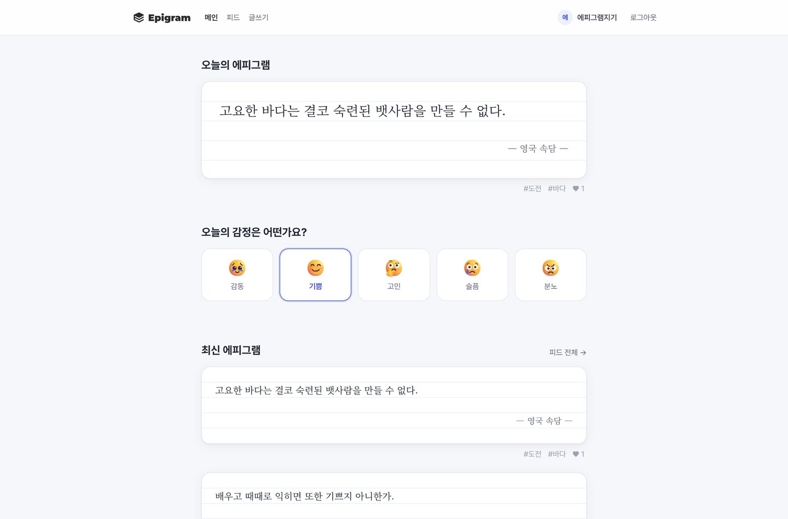
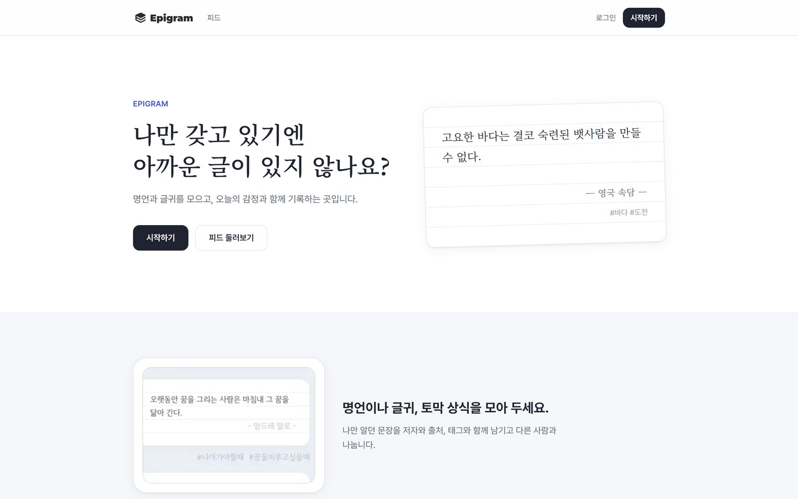
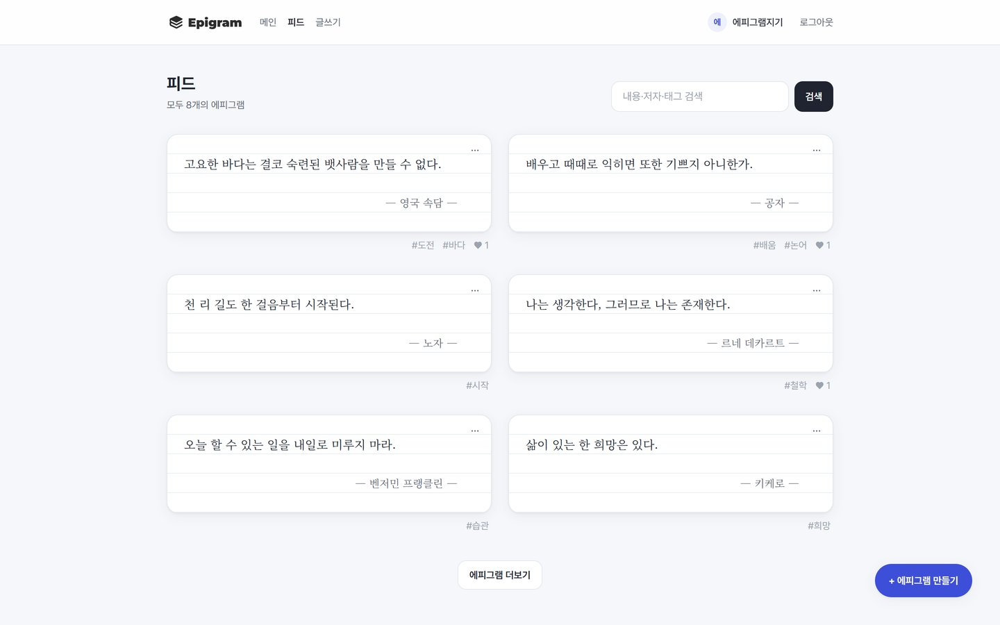
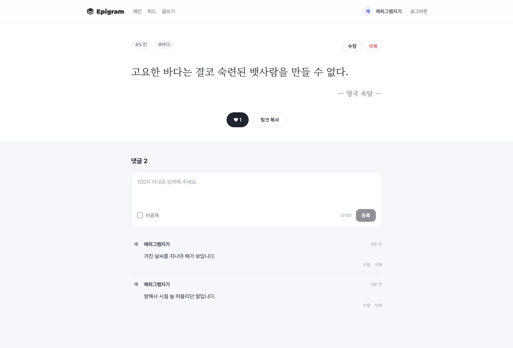
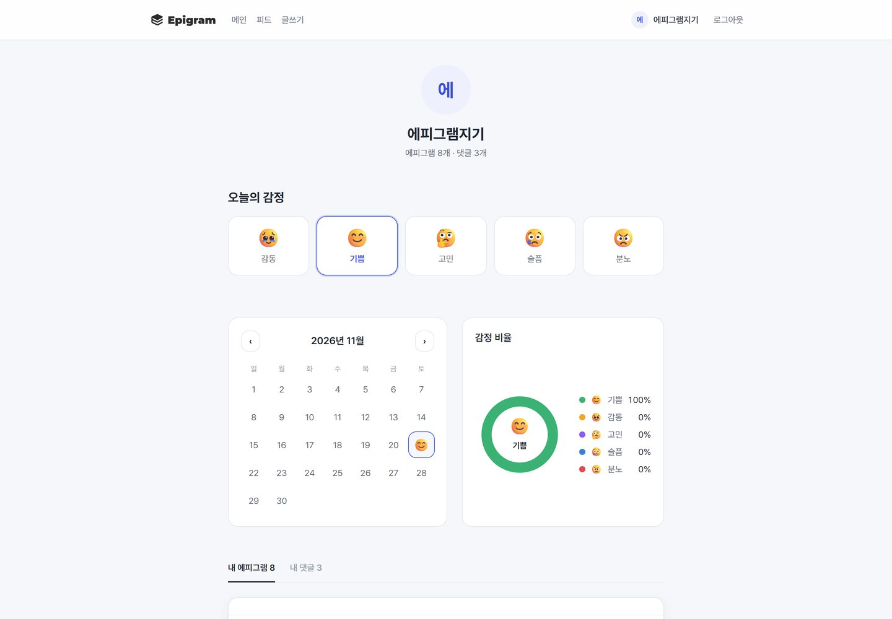

# Epigram

명언과 글귀를 모으고, 오늘의 감정과 함께 기록하는 서비스입니다.
코드잇 스프린트 프론트엔드 11기 개인 프로젝트로 시작했고, 2026년 11월에 기획된 기능을 모두 구현하고 화면을 다시 디자인해 마무리했습니다.

**배포** https://seoki-epigram.vercel.app (피드와 상세는 로그인 없이 볼 수 있습니다)



## 화면

| 랜딩 | 피드 |
| --- | --- |
|  |  |
| **상세 · 댓글** | **마이페이지 · 감정 달력** |
|  |  |

## 기능

| 화면 | 주소 | 내용 |
| --- | --- | --- |
| 랜딩 | `/` | 서비스 소개, 최신 에피그램 3개 |
| 메인 | `/main` | 오늘의 에피그램, 오늘의 감정 선택, 최신 에피그램·최신 댓글 (더보기) |
| 피드 | `/epigramlist` | 2열 카드 목록, 내용·저자·태그 검색(`?q=`), 커서 기반 더보기, 내 글 수정·삭제 메뉴 |
| 상세 | `/epigrams/[id]` | 본문·저자·출처·태그, 좋아요 켜기/끄기, 링크 복사, 댓글 작성·수정·삭제(비공개 선택)·더보기 |
| 만들기·수정 | `/addepigram`, `/epigrams/[id]/edit` | 내용 500자, 저자(직접 입력·알 수 없음·본인), 출처 제목·URL, 태그 3개(10자) |
| 마이페이지 | `/mypage` | 오늘의 감정, 월별 감정 달력, 감정 비율 도넛, 내 에피그램·내 댓글 탭 |
| 로그인·회원가입 | `/login`, `/signup` | 가입하면 바로 로그인, 로그인이 필요해서 넘어온 경우 원래 화면으로 복귀 |

## 기술

- Next.js 15 (App Router) · React 19 · TypeScript
- Tailwind CSS — 색·글꼴·그림자를 `tailwind.config.ts` 토큰으로 관리, 공통 버튼·입력칸은 `globals.css`의 컴포넌트 클래스
- 글꼴: 화면 Pretendard, 명언 본문 Noto Serif KR (`next/font`)
- Axios — accessToken 자동 첨부, 만료 시 refreshToken으로 한 번 재발급 후 재요청, 서버 오류 문구를 한국어 안내로 변환
- date-fns — 댓글 시간('3분 전'), 감정 달력

```
src/
  api/api.ts            API 클라이언트와 타입 (명세 기준)
  utils/AuthContext.tsx 로그인 상태, useRequireAuth (로그인 필요한 화면)
  components/           Header, Page, EpigramCard, EpigramForm, EmotionPicker,
                        EmotionCalendar(달력·도넛), CommentItem, AuthShell
  app/                  라우트별 화면
```

## 실행

```bash
npm install
cp .env.example .env.local   # 필요하면 API 주소 변경
npm run dev                  # http://localhost:3000
```

API는 코드잇이 제공하는 [Epigram API](https://fe-project-epigram-api.vercel.app/docs/)를 씁니다.
주소 끝의 팀 ID(`11-hyeongseok-an`)로 데이터가 분리됩니다.

## API를 쓰며 확인한 것

- **팀 ID는 영문으로.** 한글 팀 ID(`11-안형석`)는 가입·로그인은 되지만, 로그인이 필요한 요청(글쓰기·좋아요·댓글·내 정보)이 모두 403으로 거절됩니다. 영문 팀 ID로 같은 요청을 보내면 200이 나오는 것을 확인하고 바꿨습니다.
- **중복 닉네임은 500.** 이미 있는 닉네임으로 가입하면 400이 아니라 500이 옵니다. 회원가입 화면은 이 경우 '이미 사용 중인 이메일이나 닉네임일 수 있다'고 안내합니다.
- **감정 기록은 UTC 날짜.** 오늘의 감정은 `2026-11-21T00:00:00Z`처럼 UTC 자정으로 저장됩니다. 감정 달력은 서버와 같은 날짜 경계로 표시합니다.

## 2026-11 마무리 작업

1. API 명세에 맞춤 — 목록은 `limit/cursor`와 `{ list, nextCursor, totalCount }`, 댓글은 `/epigrams/{id}/comments`, 댓글 작성의 `isPrivate`, 태그 `{ id, name }`, `likeCount`·`isLiked`
2. 로그인 — 실패가 성공처럼 처리되던 문제, 콘솔에 비밀번호가 찍히던 문제, 고정된 이름 표시
3. 없던 화면 — 수정 화면, 메인(오늘의 에피그램·오늘의 감정), 마이페이지(감정 달력·감정 비율·내 활동)
4. 디자인 — 디자인 토큰, 줄 노트 카드(줄 간격과 여백을 같은 배수로 맞춤), 반응형(390px~), 불러오는 중·빈 상태·오류 상태
5. 입력 — 한글 입력 중 Enter로 태그가 두 번 들어가던 문제, 중복 태그, URL·비밀번호 규칙 검사
